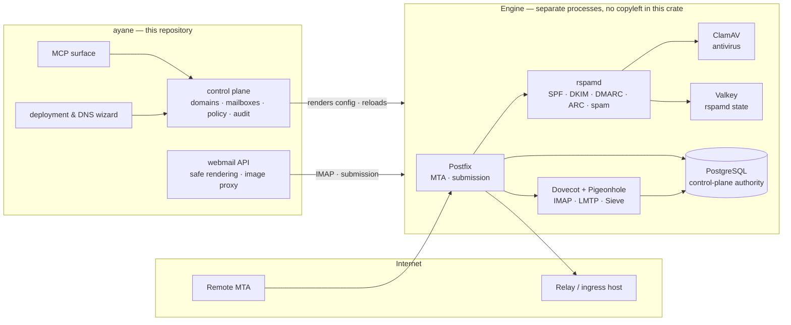

<div align="center">
  
</div>

<h1 align="center">Ayane</h1>

<div align="center">
  <strong>The mail service Celestia runs — control plane, webmail and protection over a proven Postfix/Dovecot stack</strong>
</div>

<br />

<div align="center">

**English** · [简体中文](docs/zh-Hans/README.md)

</div>

> **Status: live.** The control plane, rendered webmail, protection layer and
> the Celestia ID sign-in run on the production rig (`mail.acgsyzx.me`); the
> mail engine (Postfix / Dovecot / rspamd / ClamAV) is deployed with DKIM, SPF
> and DMARC. Inbound SMTP/25 is tested and working and rspamd rejects spam at
> the gate; outbound to the big providers is rate-limited there (PTR is live,
> Postfix retries).

## Why this exists

Self-hosted mail is a solved problem at the *engine* layer and an unsolved one at
the *organisation* layer: shared mailboxes, catch-all with allow/deny policy,
quarantine, safe rendering, a DNS wizard an operator can actually follow, and an
agent-facing surface. Ayane builds that layer and leaves SMTP/IMAP/storage to
daemons that have been in production for decades.

Named after **Ayane Okusora** (奥空 アヤネ) of Blue Archive: secretary and
communications officer of the Abydos Countermeasures Committee, a principled
rule-keeper who maintains the committee's ledger. Secretary → mailbox
administration, communications officer → routing, rule-keeper → policy and
audit, ledger → the audit trail.

The emblem — a hand-drawn colored-pencil mark in the lacrymira house style,
served from the org site — encodes the same reading: her reticle-shaped halo
(the precise ledger-keeper), the headset with boom mic (the communications
officer), the envelope (the mail), and one red accent for her red-framed
glasses.

## Architecture



## Engine and licences

Ayane owns no protocol code. The runtime stack is composed of independent
processes, each under a licence that can be operated and redistributed without
touching this repository's licence:

| Component | Role | Licence | Boundary |
|---|---|---|---|
| Postfix | MTA, submission (587) | IPL-1.0 / EPL-2.0 | separate process |
| Dovecot + Pigeonhole | IMAP, LMTP, Sieve, ACL | LGPL-2.1 | separate process |
| rspamd | spam, DKIM/SPF/DMARC/ARC, milter | Apache-2.0 | separate process |
| ClamAV | antivirus (driven by rspamd) | GPL-2.0 | separate process |
| Valkey | rspamd statistics / rate limits | BSD-3-Clause | separate process |
| PostgreSQL | control-plane authority | PostgreSQL Licence | library |

Deliberately **not** used: Stalwart (AGPL-3.0), mailcow (GPL-3.0, bundles SOGo
AGPL-3.0), Roundcube / SnappyMail (we ship our own webmail), `acme.sh`
(GPL-3.0 — ACME is done in Rust with `instant-acme`, Apache-2.0). The
`cargo deny` allow-list in `deny.toml` enforces the dependency side of this rule.

## Repository layout

```text
ayane/
  crates/
    proto/    wire types + validation (no I/O)
    mail/     routing, recipient policy, MIME construction (lettre, client only)
    engine/   deterministic renderers for Postfix / Dovecot / rspamd config
    core/     HTTP surface (`ayane` binary)
  deploy/     compose topology, parameter table, Stage-0 verification checklist
  docs/      user-facing documentation
```

## Quickstart (development)

```bash
cargo run -p ayane
curl -s http://127.0.0.1:3023/api/health
```

The bind address is a candidate for local development only; the deployment
ledger assigns the real port when the service is deployed, and `AYANE_LISTEN`
overrides it.

## Deployment parameters

The full table lives in [`deploy/README.md`](deploy/README.md). In short, an
instance is described by: the mail domain(s), the public hostname, the
certificate source (mounted / uploaded / ACME), the PostgreSQL DSN, the outbound
relay, and the bootstrap administrator. Emit them as environment variables;
never commit real values.

## Roadmap

- **Stage 0** — workspace skeleton, config renderers, health surface, deployment
  parameter table and the engine verification checklist.
- **Stage 1** — engine compose (Postfix/Dovecot/rspamd/ClamAV/Valkey) plus the
  control plane: domains, accounts, aliases, shared mailboxes, catch-all policy,
  audit, rendered-config reload loop.
- **Stage 2** — webmail API and UI on hikari: safe rendering, server-side image
  proxy, attachment hashing, sandboxed preview.
- **Stage 3** — protection depth: phishing heuristics, quarantine workflow, DNS
  wizard with live checks.
- **Stage 4** — MCP tools (read-mostly, human-in-the-loop sending) and agent
  deployment prompts.

## Licence

SySL 1.0 — see [LICENSE](LICENSE).