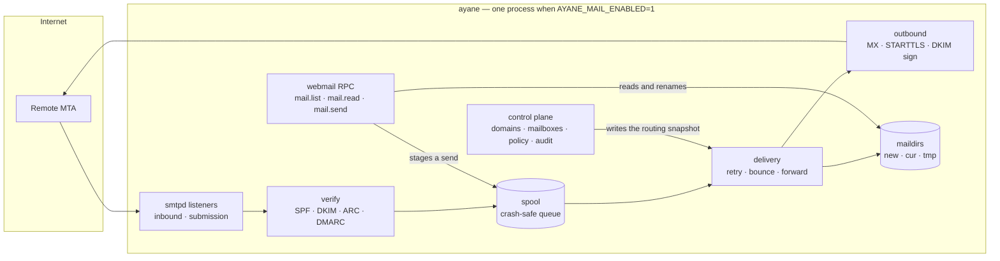

<div align="center">
  
</div>

<h1 align="center">Ayane</h1>

<div align="center">
  <strong>Der Maildienst von Celestia — eigener SMTP-Engine, ein Maildir-Lesepfad und eine Control Plane</strong>
</div>

<br />

> **Status: im Betrieb.** Die Control Plane, das gerenderte Webmail und die Anmeldung über
> Celestia ID laufen auf der Produktivumgebung (`mail.acgsyzx.me`). Die Mail-Engine ist
> eigener Code dieses Repositories: `crates/smtpd` spricht SMTP ein- und ausgehend, prüft
> SPF/DKIM/ARC/DMARC, stellt in Maildirs zu und verschickt Fremddomänen-Mail über MX mit
> DKIM-Signatur. Das Webmail liest dieselben Maildirs direkt — es gibt keinen IMAP-Server
> mehr im Stack und kein Dovecot zu konfigurieren.

## Warum es das gibt

Selbst gehostete Mail ist auf der Ebene der *Engine* ein gelöstes Problem und auf der
Ebene der *Organisation* ein ungelöstes: geteilte Postfächer, Catch-all mit Allow-/Deny-
Policy, Quarantäne, sicheres Rendern, ein DNS-Assistent, dem ein Betreiber tatsächlich
folgen kann, und eine Oberfläche für Agenten. Ayane baut diese Schicht und spricht SMTP und das Maildir-Format
selbst, statt den Daemon eines anderen zu konfigurieren.

## Der Name

Der Name stammt von **Ayane Okusora (奥空 アヤネ)** aus Blue Archive — auf Deutsch
üblicherweise als „Ayane Okusora“ wiedergegeben, wörtlich „leerer Himmel“: Sekretärin und
Kommunikationsoffizierin des Abydos-Gegenmaßnahmenkomitees, eine prinzipientreue Hüterin
der Regeln, die das Verzeichnis des Komitees führt. Sekretärin → Postfachverwaltung,
Kommunikationsoffizierin → Zustellung, Regelhüterin → Policy und Audit, Verzeichnis →
Audit-Trail.

Das Emblem — eine handgezeichnete Buntstift-Marke im Hausstil von lacrymira, ausgeliefert
von der Org-Seite — kodiert dieselbe Lesart: ihr retikel- bzw. visierförmiger
Heiligenschein (die präzise Verzeichnisführerin), das Headset mit Bügelmikrofon (die
Kommunikationsoffizierin), der Umschlag (die Mail) und ein roter Akzent für ihre Brille
mit rotem Rahmen.

## Architektur



## Engine und Lizenzen

Die Mail-Engine ist eigener Code dieses Repositories (SySL 1.0). Alles Copyleft bleibt
außerhalb des Crates:

| Komponente | Rolle | Lizenz | Grenze |
|---|---|---|---|
| `ayane-smtpd` | SMTP ein/aus, Verifikation, Queue, Zustellung, Maildir | SySL 1.0 | dieses Crate |
| `ayane-engine` | deterministische Renderer für die stillgelegten Postfix/Dovecot-Konfigurationen | SySL 1.0 | dieses Crate |
| maildir | das Mailbox-Format auf der Platte (`new`/`cur`/`tmp` je Ordner) | — | ein Dateilayout |

Bewusst **nicht** verwendet: Stalwart (AGPL-3.0), mailcow (GPL-3.0, bündelt SOGo mit
AGPL-3.0), Roundcube / SnappyMail (das Webmail ist unser eigenes) und `acme.sh`
(GPL-3.0 — ACME läuft in Rust über `instant-acme`, Apache-2.0). Die `cargo deny`-
Allow-List in `deny.toml` erzwingt die Abhängigkeitsseite dieser Regel.

## Repository-Aufbau

```text
ayane/
  crates/
    proto/    wire types + validation (no I/O)
    mail/     routing, recipient policy, MIME construction (lettre, client only)
    engine/   deterministic renderers (the retired Postfix / Dovecot configs)
    smtpd/    the mail engine: SMTP, verification, queue, delivery, maildir reader
    core/     HTTP surface (`ayane` binary)
  deploy/     compose topology, parameter table, Stage-0 verification checklist
  docs/      user-facing documentation
```

## Schnellstart (Entwicklung)

```bash
cargo run -p ayane
curl -s http://127.0.0.1:3023/api/health
```

Diese Bind-Adresse ist nur ein Kandidat für die lokale Entwicklung; den echten Port
vergibt bei der Inbetriebnahme das Deployment-Verzeichnis, und `AYANE_LISTEN` überschreibt
ihn.

## Deployment-Parameter

Die vollständige Tabelle steht in [`deploy/README.md`](../../deploy/README.md). Kurz gesagt
wird eine Instanz beschrieben durch: die Mail-Domain(s), den öffentlichen Hostnamen, die
Zertifikatsquelle (eingebunden / hochgeladen / ACME), den PostgreSQL-DSN, den ausgehenden
Relay und den Bootstrap-Administrator. Alle als Umgebungsvariablen setzen; echte Werte
niemals einchecken.

## Roadmap

- **Stage 0** — Workspace-Gerüst, Konfigurations-Renderer, Health-Oberfläche, Tabelle
  der Deployment-Parameter und die Verifikationscheckliste der Engine.
- **Stage 1** — die Mail-Engine (eingehendes SMTP, Verifikation, Queue, Zustellung,
  ausgehend) plus die Control Plane: Domains, Konten, Aliase, geteilte Postfächer,
  Catch-all-Policy, Audit, Schleife zum Neuladen.
- **Stage 2** — Webmail-API und UI auf hikari: sicheres Rendern, serverseitiger
  Bildproxy, Hashing von Anhängen, Vorschau in der Sandbox.
- **Stage 3** — mehr Tiefe im Schutz: Phishing-Heuristiken, Quarantäne-Ablauf,
  DNS-Assistent mit Live-Prüfungen.
- **Stage 4** — MCP-Werkzeuge (überwiegend lesend, Versand mit Mensch im Regelkreis)
  und Deployment-Prompts für Agenten.

## Lizenz

SySL 1.0 — siehe [LICENSE](../../LICENSE).
