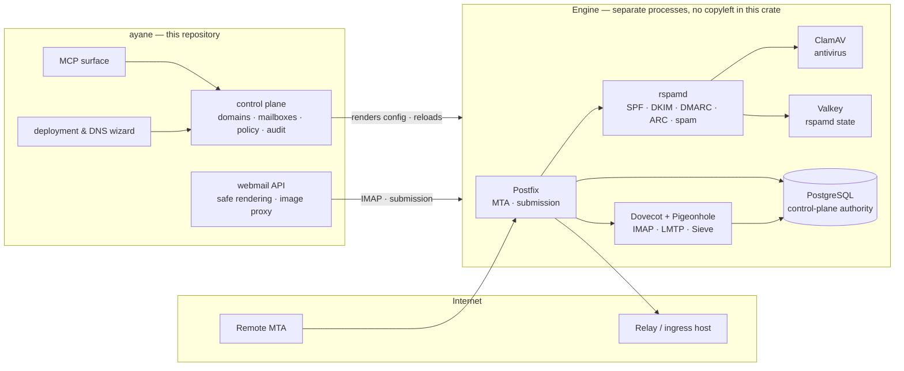

<div align="center">
  
</div>

<h1 align="center">Ayane</h1>

<div align="center">
  <strong>Der Maildienst von Celestia — Control Plane, Webmail und Schutzschicht auf einem bewährten Postfix/Dovecot-Stack</strong>
</div>

<br />

> **Status: im Betrieb.** Die Control Plane, das gerenderte Webmail, die Schutzschicht und
> die Anmeldung über Celestia ID laufen auf der Produktivumgebung (`mail.acgsyzx.me`); die
> Mail-Engine (Postfix / Dovecot / rspamd / ClamAV) ist mit DKIM, SPF und DMARC ausgerollt.
> Eingehendes SMTP auf Port 25 ist getestet und funktioniert, rspamd weist Spam schon am
> Eingang ab; ausgehend zu den großen Anbietern ist die Verbindung dort ratenbegrenzt (PTR
> ist aktiv, Postfix versucht es erneut).

## Warum es das gibt

Selbst gehostete Mail ist auf der Ebene der *Engine* ein gelöstes Problem und auf der
Ebene der *Organisation* ein ungelöstes: geteilte Postfächer, Catch-all mit Allow-/Deny-
Policy, Quarantäne, sicheres Rendern, ein DNS-Assistent, dem ein Betreiber tatsächlich
folgen kann, und eine Oberfläche für Agenten. Ayane baut diese Schicht und überlässt SMTP,
IMAP und Speicherung Daemons, die seit Jahrzehnten im Produktivbetrieb laufen.

## Der Name

Der Name stammt von **Ayane Okusora (奥空 アヤネ)** aus Blue Archive — auf Deutsch
üblicherweise als „Ayane Okusora“ wiedergegeben, wörtlich „leerer Himmel“: Sekretärin und
Kommunikationsoffizierin des Abydos-Gegenmaßnahmenkomitees, eine prinzipientreue Hüterin
der Regeln, die das Verzeichnis des Komitees führt. Sekretärin → Postfachverwaltung,
Kommunikationsoffizierin → Zustellung, Regelhüterin → Policy und Audit, Verzeichnis →
Audit-Trail.

Das Emblem — eine handgezeichnete Buntstift-Marke im Hausstil von lacrymira, ausgeliefert
von der Org-Seite — kodiert dieselbe Lesart: ihr retikel- bzw. visierförmiger
Heiligenschein (die präzise Verzeichnisführerin), das Headset mit Bügelmikrofon (die
Kommunikationsoffizierin), der Umschlag (die Mail) und ein roter Akzent für ihre Brille
mit rotem Rahmen.

## Architektur



## Engine und Lizenzen

Ayane besitzt keinen Protokollcode. Der Laufzeit-Stack besteht aus unabhängigen Prozessen,
deren jeder unter einer Lizenz betrieben und weitergegeben werden kann, ohne die Lizenz
dieses Repositories zu berühren:

| Komponente | Rolle | Lizenz | Grenze |
|---|---|---|---|
| Postfix | MTA, Submission (587) | IPL-1.0 / EPL-2.0 | eigener Prozess |
| Dovecot + Pigeonhole | IMAP, LMTP, Sieve, ACL | LGPL-2.1 | eigener Prozess |
| rspamd | Spam, DKIM/SPF/DMARC/ARC, Milter | Apache-2.0 | eigener Prozess |
| ClamAV | Antivirus (von rspamd gesteuert) | GPL-2.0 | eigener Prozess |
| Valkey | rspamd-Statistik / Rate Limits | BSD-3-Clause | eigener Prozess |
| PostgreSQL | Hoheit der Control Plane | PostgreSQL Licence | Bibliothek |

Bewusst **nicht** verwendet: Stalwart (AGPL-3.0), mailcow (GPL-3.0, bündelt SOGo mit
AGPL-3.0), Roundcube / SnappyMail (das Webmail ist unser eigenes) und `acme.sh`
(GPL-3.0 — ACME läuft in Rust über `instant-acme`, Apache-2.0). Die `cargo deny`-
Allow-List in `deny.toml` erzwingt die Abhängigkeitsseite dieser Regel.

## Repository-Aufbau

```text
ayane/
  crates/
    proto/    wire types + validation (no I/O)
    mail/     routing, recipient policy, MIME construction (lettre, client only)
    engine/   deterministic renderers for Postfix / Dovecot / rspamd config
    core/     HTTP surface (`ayane` binary)
  deploy/     compose topology, parameter table, Stage-0 verification checklist
  docs/      user-facing documentation
```

## Schnellstart (Entwicklung)

```bash
cargo run -p ayane
curl -s http://127.0.0.1:3023/api/health
```

Diese Bind-Adresse ist nur ein Kandidat für die lokale Entwicklung; den echten Port
vergibt bei der Inbetriebnahme das Deployment-Verzeichnis, und `AYANE_LISTEN` überschreibt
ihn.

## Deployment-Parameter

Die vollständige Tabelle steht in [`deploy/README.md`](../../deploy/README.md). Kurz gesagt
wird eine Instanz beschrieben durch: die Mail-Domain(s), den öffentlichen Hostnamen, die
Zertifikatsquelle (eingebunden / hochgeladen / ACME), den PostgreSQL-DSN, den ausgehenden
Relay und den Bootstrap-Administrator. Alle als Umgebungsvariablen setzen; echte Werte
niemals einchecken.

## Roadmap

- **Stage 0** — Workspace-Gerüst, Konfigurations-Renderer, Health-Oberfläche, Tabelle
  der Deployment-Parameter und die Verifikationscheckliste der Engine.
- **Stage 1** — Engine-Compose (Postfix/Dovecot/rspamd/ClamAV/Valkey) plus die Control
  Plane: Domains, Konten, Aliase, geteilte Postfächer, Catch-all-Policy, Audit, Schleife
  zum Neuladen der gerenderten Konfiguration.
- **Stage 2** — Webmail-API und UI auf hikari: sicheres Rendern, serverseitiger
  Bildproxy, Hashing von Anhängen, Vorschau in der Sandbox.
- **Stage 3** — mehr Tiefe im Schutz: Phishing-Heuristiken, Quarantäne-Ablauf,
  DNS-Assistent mit Live-Prüfungen.
- **Stage 4** — MCP-Werkzeuge (überwiegend lesend, Versand mit Mensch im Regelkreis)
  und Deployment-Prompts für Agenten.

## Lizenz

SySL 1.0 — siehe [LICENSE](../../LICENSE).
