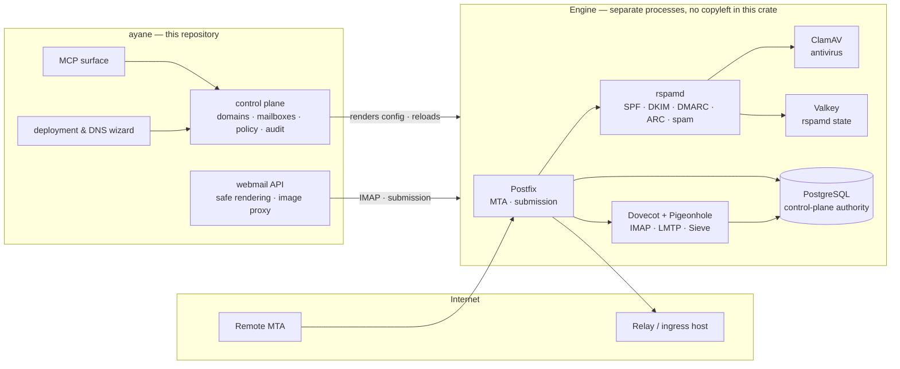

<div align="center">
  
</div>

<h1 align="center">Ayane</h1>

<div align="center">
  <strong>El servicio de correo que opera Celestia — plano de control, webmail y capa de protección sobre una pila Postfix/Dovecot probada</strong>
</div>

<br />

> **Estado: en producción.** El plano de control, el webmail renderizado, la capa de
> protección y el inicio de sesión con Celestia ID funcionan en el entorno de producción
> (`mail.acgsyzx.me`); el motor de correo (Postfix / Dovecot / rspamd / ClamAV) está
> desplegado con DKIM, SPF y DMARC. El SMTP entrante en el puerto 25 está probado y funciona,
> y rspamd rechaza el spam en la entrada; el correo saliente hacia los grandes proveedores
> tiene límite de velocidad allí (el PTR está activo y Postfix reintenta).

## Por qué existe

El correo autoalojado es un problema resuelto en la capa del *motor* y sin resolver en la
capa de la *organización*: buzones compartidos, catch-all con política de permitidos y
denegados, cuarentena, renderizado seguro, un asistente de DNS que un operador pueda seguir
de verdad y una superficie para agentes. Ayane construye esa capa y deja el SMTP, el IMAP y
el almacenamiento en manos de demonios que llevan décadas en producción.

## El nombre

El nombre viene de **Ayane Okusora (奥空 アヤネ)**, de Blue Archive — en español se
transcribe tal cual, «Ayane Okusora», del japonés «cielo vacío»: secretaria y oficial de
comunicaciones del Comité de Contramedidas de Abidos, guardiana de las normas que lleva el
registro del comité. Secretaria → administración de buzones, oficial de comunicaciones →
encaminamiento, guardiana de las normas → política y auditoría, registro → rastro de
auditoría.

El emblema —una marca dibujada a mano con lápices de colores, en el estilo de la casa
lacrymira, servida desde el sitio de la organización— codifica la misma lectura: su aureola
con forma de retícula (la llevanza precisa del registro), los auriculares con micrófono de
caña (la oficial de comunicaciones), el sobre (el correo) y un único acento rojo por sus
gafas de montura roja.

## Arquitectura



## Motores y licencias

Ayane no contiene código de protocolo. La pila en ejecución se compone de procesos
independientes, cada uno bajo una licencia que se puede operar y redistribuir sin tocar la
licencia de este repositorio:

| Componente | Función | Licencia | Frontera |
|---|---|---|---|
| Postfix | MTA, submission (587) | IPL-1.0 / EPL-2.0 | proceso aparte |
| Dovecot + Pigeonhole | IMAP, LMTP, Sieve, ACL | LGPL-2.1 | proceso aparte |
| rspamd | spam, DKIM/SPF/DMARC/ARC, milter | Apache-2.0 | proceso aparte |
| ClamAV | antivirus (lo dirige rspamd) | GPL-2.0 | proceso aparte |
| Valkey | estadísticas y límites de velocidad de rspamd | BSD-3-Clause | proceso aparte |
| PostgreSQL | autoridad del plano de control | PostgreSQL Licence | biblioteca |

Deliberadamente **no** se usan: Stalwart (AGPL-3.0), mailcow (GPL-3.0, incluye SOGo en
AGPL-3.0), Roundcube / SnappyMail (el webmail es nuestro) ni `acme.sh` (GPL-3.0 — el ACME
se hace en Rust con `instant-acme`, Apache-2.0). La lista de permitidos de `cargo deny` en
`deny.toml` hace cumplir la parte de dependencias de esta regla.

## Estructura del repositorio

```text
ayane/
  crates/
    proto/    wire types + validation (no I/O)
    mail/     routing, recipient policy, MIME construction (lettre, client only)
    engine/   deterministic renderers for Postfix / Dovecot / rspamd config
    core/     HTTP surface (`ayane` binary)
  deploy/     compose topology, parameter table, Stage-0 verification checklist
  docs/      user-facing documentation
```

## Inicio rápido (desarrollo)

```bash
cargo run -p ayane
curl -s http://127.0.0.1:3023/api/health
```

Esta dirección de escucha solo es una candidata para desarrollo local; el registro de
despliegue asigna el puerto real cuando se despliega el servicio, y `AYANE_LISTEN` la
sustituye.

## Parámetros de despliegue

La tabla completa está en [`deploy/README.md`](../../deploy/README.md). En resumen, una
instancia se describe con: el dominio o los dominios de correo, el nombre de host público,
el origen del certificado (montado / subido / ACME), el DSN de PostgreSQL, el relay de
salida y el administrador inicial. Pásalos como variables de entorno; nunca confirmes
valores reales.

## Hoja de ruta

- **Stage 0** — esqueleto del espacio de trabajo, renderizadores de configuración,
  superficie de salud, tabla de parámetros de despliegue y la lista de verificación de los
  motores.
- **Stage 1** — compose de los motores (Postfix/Dovecot/rspamd/ClamAV/Valkey) y el plano
  de control: dominios, cuentas, alias, buzones compartidos, política catch-all, auditoría
  y el bucle de recarga de la configuración renderizada.
- **Stage 2** — API e interfaz de webmail sobre hikari: renderizado seguro, proxy de
  imágenes en el servidor, hash de los adjuntos, vista previa en caja de arena.
- **Stage 3** — más profundidad en la protección: heurísticas de phishing, flujo de
  cuarentena, asistente de DNS con comprobaciones en vivo.
- **Stage 4** — herramientas MCP (sobre todo de lectura, envío con una persona en el
  bucle) y prompts de despliegue para agentes.

## Licencia

SySL 1.0 — consulta [LICENSE](../../LICENSE).
