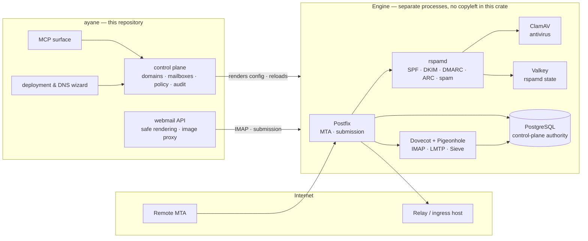

<div align="center">
  
</div>

<h1 align="center">Ayane</h1>

<div align="center">
  <strong>Le service de messagerie que Celestia exploite — plan de contrôle, webmail et couche de protection sur une pile Postfix/Dovecot éprouvée</strong>
</div>

<br />

> **État : en production.** Le plan de contrôle, le webmail rendu côté serveur, la couche de
> protection et la connexion via Celestia ID tournent sur l'environnement de production
> (`mail.acgsyzx.me`) ; le moteur de messagerie (Postfix / Dovecot / rspamd / ClamAV) est
> déployé avec DKIM, SPF et DMARC. Le SMTP entrant sur le port 25 est testé et fonctionnel,
> et rspamd rejette le spam dès l'entrée ; le trafic sortant vers les grands fournisseurs y
> est limité en débit (le PTR est actif, Postfix réessaie).

## Pourquoi ce projet existe

La messagerie auto-hébergée est un problème résolu au niveau du *moteur* et non résolu au
niveau de l'*organisation* : boîtes partagées, catch-all avec politique d'autorisation et
de refus, quarantaine, rendu sûr, un assistant DNS qu'un opérateur peut réellement suivre,
et une surface exploitable par des agents. Ayane construit cette couche et laisse le SMTP,
l'IMAP et le stockage à des démons éprouvés depuis des décennies en production.

## Le nom

Le nom vient d'**Ayane Okusora (奥空 アヤネ)**, personnage de Blue Archive — en français,
on écrit simplement « Ayane Okusora », dérivé du japonais signifiant « ciel vide » :
secrétaire et officière de communication du comité de contre-mesures d'Abydos, gardienne
des règles attachée à ses principes, qui tient le registre du comité. Secrétaire →
administration des boîtes aux lettres, officière de communication → routage, gardienne des
règles → politique et audit, registre → piste d'audit.

L'emblème — une marque au crayon de couleur dessinée à la main, dans le style maison de
lacrymira, servie depuis le site de l'organisation — encode la même lecture : son auréole en
forme de réticule (la tenue de registre précise), le casque à micro perche (l'officière de
communication), l'enveloppe (le courrier) et un unique accent rouge pour ses lunettes à
monture rouge.

## Architecture



## Moteurs et licences

Ayane ne contient aucun code de protocole. La pile d'exécution est composée de processus
indépendants, dont chacun peut être exploité et redistribué sans toucher à la licence de ce
dépôt :

| Composant | Rôle | Licence | Frontière |
|---|---|---|---|
| Postfix | MTA, soumission (587) | IPL-1.0 / EPL-2.0 | processus séparé |
| Dovecot + Pigeonhole | IMAP, LMTP, Sieve, ACL | LGPL-2.1 | processus séparé |
| rspamd | spam, DKIM/SPF/DMARC/ARC, milter | Apache-2.0 | processus séparé |
| ClamAV | antivirus (piloté par rspamd) | GPL-2.0 | processus séparé |
| Valkey | statistiques et limites de débit de rspamd | BSD-3-Clause | processus séparé |
| PostgreSQL | autorité du plan de contrôle | PostgreSQL Licence | bibliothèque |

Délibérément **non** utilisés : Stalwart (AGPL-3.0), mailcow (GPL-3.0, embarque SOGo en
AGPL-3.0), Roundcube / SnappyMail (le webmail est le nôtre) et `acme.sh` (GPL-3.0 —
l'ACME est fait en Rust avec `instant-acme`, Apache-2.0). La liste d'autorisation de
`cargo deny` dans `deny.toml` applique le volet « dépendances » de cette règle.

## Organisation du dépôt

```text
ayane/
  crates/
    proto/    wire types + validation (no I/O)
    mail/     routing, recipient policy, MIME construction (lettre, client only)
    engine/   deterministic renderers for Postfix / Dovecot / rspamd config
    core/     HTTP surface (`ayane` binary)
  deploy/     compose topology, parameter table, Stage-0 verification checklist
  docs/      user-facing documentation
```

## Démarrage rapide (développement)

```bash
cargo run -p ayane
curl -s http://127.0.0.1:3023/api/health
```

Cette adresse d'écoute n'est qu'une candidate pour le développement local ; c'est le
registre de déploiement qui attribue le vrai port au moment du déploiement, et
`AYANE_LISTEN` la remplace.

## Paramètres de déploiement

Le tableau complet se trouve dans [`deploy/README.md`](../../deploy/README.md). En bref, une
instance est décrite par : le ou les domaines de messagerie, le nom d'hôte public, la source
du certificat (monté / téléversé / ACME), le DSN PostgreSQL, le relais sortant et
l'administrateur initial. Fournissez-les en variables d'environnement ; ne validez jamais
de valeurs réelles.

## Feuille de route

- **Stage 0** — squelette de l'espace de travail, moteurs de rendu de configuration,
  surface de santé, tableau des paramètres de déploiement et check-list de vérification
  des moteurs.
- **Stage 1** — compose des moteurs (Postfix/Dovecot/rspamd/ClamAV/Valkey) et plan de
  contrôle : domaines, comptes, alias, boîtes partagées, politique catch-all, audit,
  boucle de rechargement de la configuration rendue.
- **Stage 2** — API et interface webmail sur hikari : rendu sûr, proxy d'images côté
  serveur, hachage des pièces jointes, aperçu en bac à sable.
- **Stage 3** — protection plus profonde : heuristiques anti-hameçonnage, circuit de
  quarantaine, assistant DNS avec vérifications en direct.
- **Stage 4** — outils MCP (surtout en lecture, envoi avec un humain dans la boucle) et
  prompts de déploiement pour les agents.

## Licence

SySL 1.0 — voir [LICENSE](../../LICENSE).
