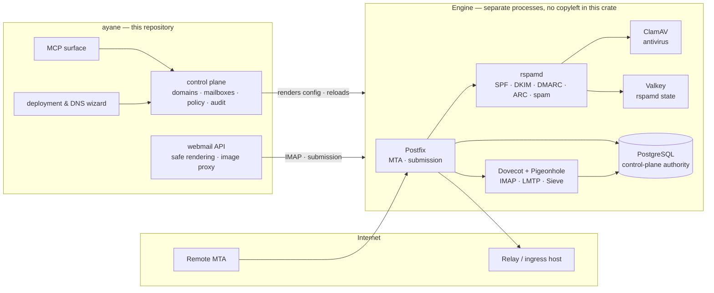

<div align="center">
  
</div>

<h1 align="center">Ayane</h1>

<div align="center">
  <strong>Celestia が運用するメールサービス — 実績ある Postfix/Dovecot スタック上のコントロールプレーン、Webmail、保護レイヤー</strong>
</div>

<br />

> **ステータス：稼働中。** コントロールプレーン、描画型 Webmail、保護レイヤー、そして
> Celestia ID によるサインインは、すでに本番環境（`mail.acgsyzx.me`）で動いています。
> メールエンジン（Postfix / Dovecot / rspamd / ClamAV）も DKIM・SPF・DMARC 付きで
> デプロイ済みです。受信側の SMTP/25 は実測で動作を確認しており、rspamd は入口の
> 時点で迷惑メールを弾きます。大手プロバイダ宛の送信はこの環境ではレート制限を受け
> ます（PTR は有効化済みで、Postfix が自動的に再試行します）。

## なぜこれを作るのか

セルフホストのメールは、**エンジン**層ではすでに解決済みの問題ですが、**組織**層では
まだ解決していません。共有メールボックス、許可・拒否ポリシー付きの catch-all、隔離、
安全な描画、運用者が実際にたどれる DNS ウィザード、そしてエージェント向けの操作面が
必要です。Ayane が作るのはこの層であり、SMTP・IMAP・ストレージは何十年も本番で
動いてきたデーモンに任せます。

## 名前の由来

名前は『ブルーアーカイブ』の**奥空 アヤネ**に由来します。アビドス高等学校対策委員会の
書記であり通信担当でもある、規律を重んじ、委員会の記録を管理する人物です。
書記 → メールボックス管理、通信担当 → 配送、規律 → ポリシーと監査、記録 → 監査証跡。

エンブレムは lacrymira 一門の様式による手描きの色鉛筆マークで、org サイトから配信
され、同じ読み解きを符号化しています。レティクル（照準環）状のハロー（寸分違わぬ
記録係）、ブームマイク付きのヘッドセット（通信担当）、封筒（メール）、そして赤縁
眼鏡を指す一つの赤いアクセントです。

## アーキテクチャ



## エンジンとライセンス

Ayane はプロトコル実装のコードを一切持ちません。実行時のスタックは独立したプロセス群
で構成されており、どのプロセスも本リポジトリのライセンスに触れることなく運用・再
配布できます。

| コンポーネント | 役割 | ライセンス | 境界 |
|---|---|---|---|
| Postfix | MTA、submission（587） | IPL-1.0 / EPL-2.0 | 独立プロセス |
| Dovecot + Pigeonhole | IMAP、LMTP、Sieve、ACL | LGPL-2.1 | 独立プロセス |
| rspamd | 迷惑メール、DKIM/SPF/DMARC/ARC、milter | Apache-2.0 | 独立プロセス |
| ClamAV | アンチウイルス（rspamd から駆動） | GPL-2.0 | 独立プロセス |
| Valkey | rspamd の統計・レート制限 | BSD-3-Clause | 独立プロセス |
| PostgreSQL | コントロールプレーンの権威 | PostgreSQL Licence | ライブラリ |

意図的に**使わない**もの：Stalwart（AGPL-3.0）、mailcow（GPL-3.0、SOGo
AGPL-3.0 を同梱）、Roundcube / SnappyMail（Webmail は自前で提供）、`acme.sh`
（GPL-3.0 — ACME は Rust の `instant-acme` で実装、Apache-2.0）。`deny.toml` の
`cargo deny` allow-list が、この規則の依存関係側を機械的に担保します。

## リポジトリ構成

```text
ayane/
  crates/
    proto/    wire types + validation (no I/O)
    mail/     routing, recipient policy, MIME construction (lettre, client only)
    engine/   deterministic renderers for Postfix / Dovecot / rspamd config
    core/     HTTP surface (`ayane` binary)
  deploy/     compose topology, parameter table, Stage-0 verification checklist
  docs/      user-facing documentation
```

## クイックスタート（開発）

```bash
cargo run -p ayane
curl -s http://127.0.0.1:3023/api/health
```

このバインドアドレスはローカル開発専用の候補です。実際のポートはデプロイ時に
デプロイ台帳が割り当て、`AYANE_LISTEN` で上書きできます。

## デプロイパラメータ

一覧表は [`deploy/README.md`](../../deploy/README.md) にあります。要点だけ書くと、
インスタンスはメールドメイン、公開ホスト名、証明書の取得元（マウント／アップロード／
ACME）、PostgreSQL の DSN、送信リレー、初期管理者で記述されます。これらは環境変数
として渡し、実際の値をコミットしてはいけません。

## ロードマップ

- **Stage 0** — ワークスペースの骨組み、設定レンダラー、ヘルスチェック面、デプロイ
  パラメータ表、エンジン検証チェックリスト。
- **Stage 1** — エンジンの compose（Postfix/Dovecot/rspamd/ClamAV/Valkey）と
  コントロールプレーン：ドメイン、アカウント、エイリアス、共有メールボックス、
  catch-all ポリシー、監査、レンダリング済み設定の再読み込みループ。
- **Stage 2** — hikari 上の Webmail API と UI：安全な描画、サーバー側画像プロキシ、
  添付ファイルのハッシュ、サンドボックス付きプレビュー。
- **Stage 3** — 保護の深化：フィッシングのヒューリスティック、隔離ワークフロー、
  実検査を伴う DNS ウィザード。
- **Stage 4** — MCP ツール（読み取り中心、送信は人間をループに入れる）とエージェント
  向けデプロイ用プロンプト。

## ライセンス

SySL 1.0 — [LICENSE](../../LICENSE) を参照してください。
