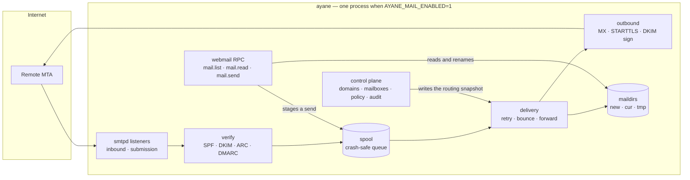

<div align="center">
  
</div>

<h1 align="center">Ayane</h1>

<div align="center">
  <strong>Celestia が運用するメールサービス — 自前の SMTP エンジン、maildir の読み取り経路、コントロールプレーン</strong>
</div>

<br />

> **ステータス：稼働中。** コントロールプレーン、描画型 Webmail、Celestia ID による
> サインインは本番環境（`mail.acgsyzx.me`）で動いています。メールエンジンはこのリポジトリ
> 自身のコードです。`crates/smtpd` が受信と submission の SMTP を話し、SPF・DKIM・ARC・
> DMARC を検証し、maildir へ配送し、他ドメイン宛は DKIM 署名付きで MX へ送ります。
> Webmail は同じ maildir を直接読みます。IMAP サーバはもう無く、Dovecot の設定もありません。

## なぜこれを作るのか

セルフホストのメールは、**エンジン**層ではすでに解決済みの問題ですが、**組織**層では
まだ解決していません。共有メールボックス、許可・拒否ポリシー付きの catch-all、隔離、
安全な描画、運用者が実際にたどれる DNS ウィザード、そしてエージェント向けの操作面が
必要です。Ayane が作るのはこの層であり、SMTP と maildir 形式は自分で話し、
他人のデーモンを設定するのではなくなります。

## 名前の由来

名前は『ブルーアーカイブ』の**奥空 アヤネ**に由来します。アビドス高等学校対策委員会の
書記であり通信担当でもある、規律を重んじ、委員会の記録を管理する人物です。
書記 → メールボックス管理、通信担当 → 配送、規律 → ポリシーと監査、記録 → 監査証跡。

エンブレムは lacrymira 一門の様式による手描きの色鉛筆マークで、org サイトから配信
され、同じ読み解きを符号化しています。レティクル（照準環）状のハロー（寸分違わぬ
記録係）、ブームマイク付きのヘッドセット（通信担当）、封筒（メール）、そして赤縁
眼鏡を指す一つの赤いアクセントです。

## アーキテクチャ



## エンジンとライセンス

メールエンジンはこのリポジトリ自身のコードです（SySL 1.0）。copyleft のものはすべて
クレートの外に置きます:

| コンポーネント | 役割 | ライセンス | 境界 |
|---|---|---|---|
| `ayane-smtpd` | SMTP の受信・送信、検証、キュー、配送、maildir | SySL 1.0 | このクレート |
| `ayane-engine` | 廃止した Postfix / Dovecot 設定の決定的レンダラ | SySL 1.0 | このクレート |
| maildir | ディスク上のメールボックス形式（各フォルダの `new`/`cur`/`tmp`） | — | ファイル配置 |

意図的に**使わない**もの: Stalwart（AGPL-3.0）、mailcow（GPL-3.0、SOGo AGPL-3.0 を同梱）、
Roundcube / SnappyMail（Webmail は自前）、`acme.sh`（GPL-3.0 — ACME は Rust の
`instant-acme`、Apache-2.0）。`deny.toml` の `cargo deny` 許可リストが、この規約の
依存関係側を強制します。

## リポジトリ構成

```text
ayane/
  crates/
    proto/    wire types + validation (no I/O)
    mail/     routing, recipient policy, MIME construction (lettre, client only)
    engine/   deterministic renderers (the retired Postfix / Dovecot configs)
    smtpd/    the mail engine: SMTP, verification, queue, delivery, maildir reader
    core/     HTTP surface (`ayane` binary)
  deploy/     compose topology, parameter table, Stage-0 verification checklist
  docs/      user-facing documentation
```

## クイックスタート（開発）

```bash
cargo run -p ayane
curl -s http://127.0.0.1:3023/api/health
```

このバインドアドレスはローカル開発専用の候補です。実際のポートはデプロイ時に
デプロイ台帳が割り当て、`AYANE_LISTEN` で上書きできます。

## デプロイパラメータ

一覧表は [`deploy/README.md`](../../deploy/README.md) にあります。要点だけ書くと、
インスタンスはメールドメイン、公開ホスト名、証明書の取得元（マウント／アップロード／
ACME）、PostgreSQL の DSN、送信リレー、初期管理者で記述されます。これらは環境変数
として渡し、実際の値をコミットしてはいけません。

## ロードマップ

- **Stage 0** — ワークスペースの骨組み、設定レンダラー、ヘルスチェック面、デプロイ
  パラメータ表、エンジン検証チェックリスト。
- **Stage 1** — メールエンジン（受信 SMTP、検証、キュー、配送、送信）と
  コントロールプレーン：ドメイン、アカウント、エイリアス、共有メールボックス、
  catch-all ポリシー、監査、再読み込みループ。
- **Stage 2** — hikari 上の Webmail API と UI：安全な描画、サーバー側画像プロキシ、
  添付ファイルのハッシュ、サンドボックス付きプレビュー。
- **Stage 3** — 保護の深化：フィッシングのヒューリスティック、隔離ワークフロー、
  実検査を伴う DNS ウィザード。
- **Stage 4** — MCP ツール（読み取り中心、送信は人間をループに入れる）とエージェント
  向けデプロイ用プロンプト。

## ライセンス

SySL 1.0 — [LICENSE](../../LICENSE) を参照してください。
