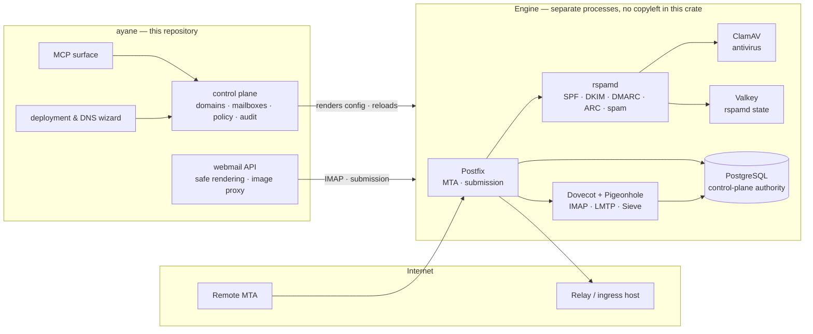

<div align="center">
  
</div>

<h1 align="center">Ayane</h1>

<div align="center">
  <strong>Celestia가 운영하는 메일 서비스 — 검증된 Postfix/Dovecot 스택 위의 컨트롤 플레인, 웹메일, 보호 계층</strong>
</div>

<br />

> **상태: 운영 중.** 컨트롤 플레인, 렌더링 웹메일, 보호 계층, Celestia ID 로그인이 모두
> 실제 운영 환경(`mail.acgsyzx.me`)에서 돌고 있으며, 메일 엔진(Postfix / Dovecot /
> rspamd / ClamAV)도 DKIM·SPF·DMARC까지 갖춰 배포되어 있습니다. 수신 SMTP 25번 포트는
> 실측으로 동작이 확인되었고 rspamd가 입구에서 스팸을 걸러냅니다. 대형 사업자로 나가는
> 발송은 이 환경에서 속도 제한을 받습니다(PTR은 적용되어 있고 Postfix가 자동으로
> 재시도합니다).

## 왜 만드는가

직접 호스팅하는 메일은 **엔진** 계층에서는 이미 해결된 문제지만, **조직** 계층에서는
아직 해결되지 않았습니다. 공용 사서함, 허용·차단 정책을 갖춘 catch-all, 격리, 안전한
렌더링, 운영자가 실제로 따라갈 수 있는 DNS 마법사, 그리고 에이전트가 붙을 수 있는
표면이 필요합니다. Ayane이 만드는 것이 바로 이 계층이고, SMTP·IMAP·저장소는 수십 년째
운영 환경에서 쓰이는 데몬에 맡깁니다.

## 이름의 유래

이름은 《블루 아카이브》의 **오쿠소라 아야네(奥空 アヤネ)** 에서 따왔습니다. 아비도스
대책위원회의 서기이자 통신 담당으로, 원칙을 지키고 위원회의 장부를 관리하는 인물입니다.
서기 → 사서함 관리, 통신 담당 → 라우팅, 원칙 → 정책과 감사, 장부 → 감사 추적.

엠블럼은 lacrymira 하우스 스타일의 손그림 색연필 마크로, 조직 사이트에서 제공되며 같은
해석을 담고 있습니다. 조준선 모양의 헤일로(빈틈없는 장부 담당), 붐 마이크가 달린
헤드셋(통신 담당), 봉투(메일), 그리고 빨간 테 안경을 가리키는 붉은 강조 하나입니다.

## 아키텍처



## 엔진과 라이선스

Ayane은 프로토콜 구현 코드를 직접 소유하지 않습니다. 실행 스택은 독립된 프로세스들로
구성되며, 각 프로세스는 이 저장소의 라이선스를 건드리지 않고도 운영하고 재배포할 수
있습니다.

| 구성 요소 | 역할 | 라이선스 | 경계 |
|---|---|---|---|
| Postfix | MTA, submission(587) | IPL-1.0 / EPL-2.0 | 독립 프로세스 |
| Dovecot + Pigeonhole | IMAP, LMTP, Sieve, ACL | LGPL-2.1 | 독립 프로세스 |
| rspamd | 스팸, DKIM/SPF/DMARC/ARC, milter | Apache-2.0 | 독립 프로세스 |
| ClamAV | 백신(rspamd가 구동) | GPL-2.0 | 독립 프로세스 |
| Valkey | rspamd 통계·속도 제한 | BSD-3-Clause | 독립 프로세스 |
| PostgreSQL | 컨트롤 플레인의 권위 | PostgreSQL Licence | 라이브러리 |

의도적으로 **쓰지 않는** 것: Stalwart(AGPL-3.0), mailcow(GPL-3.0, SOGo
AGPL-3.0 포함), Roundcube / SnappyMail(웹메일은 직접 제공), `acme.sh`(GPL-3.0 —
ACME는 Rust의 `instant-acme`로 구현, Apache-2.0). `deny.toml`의 `cargo deny` 허용
목록이 이 규칙의 의존성 쪽을 기계적으로 강제합니다.

## 저장소 구조

```text
ayane/
  crates/
    proto/    wire types + validation (no I/O)
    mail/     routing, recipient policy, MIME construction (lettre, client only)
    engine/   deterministic renderers for Postfix / Dovecot / rspamd config
    core/     HTTP surface (`ayane` binary)
  deploy/     compose topology, parameter table, Stage-0 verification checklist
  docs/      user-facing documentation
```

## 빠른 시작(개발)

```bash
cargo run -p ayane
curl -s http://127.0.0.1:3023/api/health
```

이 바인드 주소는 로컬 개발용 후보일 뿐입니다. 실제 포트는 배포 시점에 배포 원장이
할당하며, `AYANE_LISTEN`으로 덮어쓸 수 있습니다.

## 배포 파라미터

전체 표는 [`deploy/README.md`](../../deploy/README.md)에 있습니다. 요약하면 인스턴스는
메일 도메인, 공개 호스트명, 인증서 원천(마운트/업로드/ACME), PostgreSQL DSN, 아웃바운드
릴레이, 부트스트랩 관리자로 기술됩니다. 이 값들은 환경 변수로 넘기고, 실제 값은 절대
커밋하지 마십시오.

## 로드맵

- **Stage 0** — 워크스페이스 골격, 설정 렌더러, 헬스 표면, 배포 파라미터 표, 엔진
  검증 체크리스트.
- **Stage 1** — 엔진 compose(Postfix/Dovecot/rspamd/ClamAV/Valkey)와 컨트롤 플레인:
  도메인, 계정, 별칭, 공용 사서함, catch-all 정책, 감사, 렌더링 설정 재적용 루프.
- **Stage 2** — hikari 기반 웹메일 API와 UI: 안전한 렌더링, 서버 측 이미지 프록시,
  첨부 파일 해싱, 샌드박스 미리보기.
- **Stage 3** — 보호 심화: 피싱 휴리스틱, 격리 워크플로, 실시간 점검이 붙은 DNS
  마법사.
- **Stage 4** — MCP 도구(읽기 중심, 발송은 사람이 루프 안에)와 에이전트 배포 프롬프트.

## 라이선스

SySL 1.0 — [LICENSE](../../LICENSE)를 참고하십시오.
