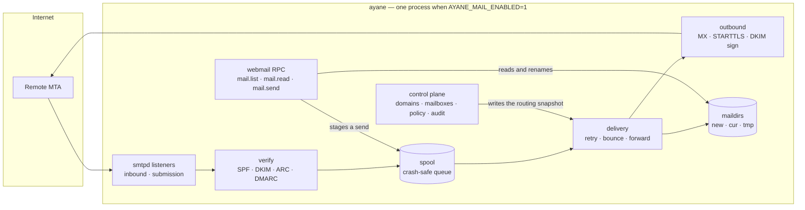

<div align="center">
  
</div>

<h1 align="center">Ayane</h1>

<div align="center">
  <strong>Celestia가 운영하는 메일 서비스 — 자체 SMTP 엔진, maildir 읽기 경로, 컨트롤 플레인</strong>
</div>

<br />

> **상태: 운영 중.** 컨트롤 플레인, 렌더링 웹메일, Celestia ID 로그인이 실제 운영
> 환경(`mail.acgsyzx.me`)에서 돌고 있습니다. 메일 엔진은 이 저장소의 자체 코드입니다:
> `crates/smtpd`가 수신과 submission의 SMTP를 말하고, SPF·DKIM·ARC·DMARC를 검증하며,
> maildir로 배달하고, 다른 도메인으로는 DKIM 서명과 함께 MX로 보냅니다. 웹메일은 같은
> maildir을 직접 읽습니다. IMAP 서버는 더 이상 없고 Dovecot 설정도 없습니다.

## 왜 만드는가

직접 호스팅하는 메일은 **엔진** 계층에서는 이미 해결된 문제지만, **조직** 계층에서는
아직 해결되지 않았습니다. 공용 사서함, 허용·차단 정책을 갖춘 catch-all, 격리, 안전한
렌더링, 운영자가 실제로 따라갈 수 있는 DNS 마법사, 그리고 에이전트가 붙을 수 있는
표면이 필요합니다. Ayane이 만드는 것이 바로 이 계층이고, SMTP와 maildir 형식을 직접 말하고,
남의 데몬을 설정하지 않습니다.

## 이름의 유래

이름은 《블루 아카이브》의 **오쿠소라 아야네(奥空 アヤネ)** 에서 따왔습니다. 아비도스
대책위원회의 서기이자 통신 담당으로, 원칙을 지키고 위원회의 장부를 관리하는 인물입니다.
서기 → 사서함 관리, 통신 담당 → 라우팅, 원칙 → 정책과 감사, 장부 → 감사 추적.

엠블럼은 lacrymira 하우스 스타일의 손그림 색연필 마크로, 조직 사이트에서 제공되며 같은
해석을 담고 있습니다. 조준선 모양의 헤일로(빈틈없는 장부 담당), 붐 마이크가 달린
헤드셋(통신 담당), 봉투(메일), 그리고 빨간 테 안경을 가리키는 붉은 강조 하나입니다.

## 아키텍처



## 엔진과 라이선스

메일 엔진은 이 저장소의 자체 코드입니다(SySL 1.0). copyleft인 것은 모두 크레이트 밖에
둡니다:

| 구성 요소 | 역할 | 라이선스 | 경계 |
|---|---|---|---|
| `ayane-smtpd` | SMTP 수신·발신, 검증, 큐, 배달, maildir | SySL 1.0 | 이 크레이트 |
| `ayane-engine` | 폐기된 Postfix / Dovecot 설정의 결정적 렌더러 | SySL 1.0 | 이 크레이트 |
| maildir | 디스크상의 편지함 형식(폴더별 `new`/`cur`/`tmp`) | — | 파일 배치 |

의도적으로 **쓰지 않는** 것: Stalwart(AGPL-3.0), mailcow(GPL-3.0, SOGo AGPL-3.0 포함),
Roundcube / SnappyMail(웹메일은 자체), `acme.sh`(GPL-3.0 — ACME는 Rust의
`instant-acme`, Apache-2.0). `deny.toml`의 `cargo deny` 허용 목록이 이 규칙의 의존성
쪽을 강제합니다.

## 저장소 구조

```text
ayane/
  crates/
    proto/    wire types + validation (no I/O)
    mail/     routing, recipient policy, MIME construction (lettre, client only)
    engine/   deterministic renderers (the retired Postfix / Dovecot configs)
    smtpd/    the mail engine: SMTP, verification, queue, delivery, maildir reader
    core/     HTTP surface (`ayane` binary)
  deploy/     compose topology, parameter table, Stage-0 verification checklist
  docs/      user-facing documentation
```

## 빠른 시작(개발)

```bash
cargo run -p ayane
curl -s http://127.0.0.1:3023/api/health
```

이 바인드 주소는 로컬 개발용 후보일 뿐입니다. 실제 포트는 배포 시점에 배포 원장이
할당하며, `AYANE_LISTEN`으로 덮어쓸 수 있습니다.

## 배포 파라미터

전체 표는 [`deploy/README.md`](../../deploy/README.md)에 있습니다. 요약하면 인스턴스는
메일 도메인, 공개 호스트명, 인증서 원천(마운트/업로드/ACME), PostgreSQL DSN, 아웃바운드
릴레이, 부트스트랩 관리자로 기술됩니다. 이 값들은 환경 변수로 넘기고, 실제 값은 절대
커밋하지 마십시오.

## 로드맵

- **Stage 0** — 워크스페이스 골격, 설정 렌더러, 헬스 표면, 배포 파라미터 표, 엔진
  검증 체크리스트.
- **Stage 1** — 메일 엔진(수신 SMTP, 검증, 큐, 배달, 발신)과 컨트롤 플레인:
  도메인, 계정, 별칭, 공용 사서함, catch-all 정책, 감사, 재적용 루프.
- **Stage 2** — hikari 기반 웹메일 API와 UI: 안전한 렌더링, 서버 측 이미지 프록시,
  첨부 파일 해싱, 샌드박스 미리보기.
- **Stage 3** — 보호 심화: 피싱 휴리스틱, 격리 워크플로, 실시간 점검이 붙은 DNS
  마법사.
- **Stage 4** — MCP 도구(읽기 중심, 발송은 사람이 루프 안에)와 에이전트 배포 프롬프트.

## 라이선스

SySL 1.0 — [LICENSE](../../LICENSE)를 참고하십시오.
