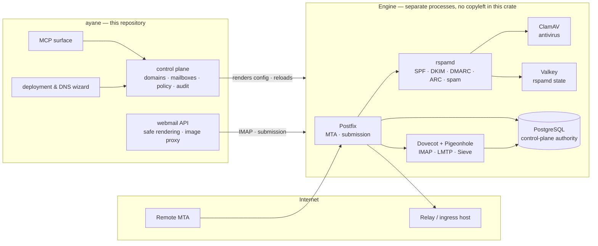

<div align="center">
  
</div>

<h1 align="center">Ayane</h1>

<div align="center">
  <strong>Почтовый сервис Celestia — плоскость управления, веб-почта и защитный слой поверх проверенного стека Postfix/Dovecot</strong>
</div>

<br />

> **Статус: в эксплуатации.** Плоскость управления, отрисовываемая веб-почта, защитный слой и
> вход через Celestia ID работают в промышленной среде (`mail.acgsyzx.me`); почтовый
> движок (Postfix / Dovecot / rspamd / ClamAV) развёрнут вместе с DKIM, SPF и DMARC.
> Входящий SMTP на порт 25 проверен и работает, rspamd отсекает спам уже на входе;
> исходящие сообщения к крупным провайдерам там ограничены по скорости (PTR действует,
> Postfix повторяет попытки).

## Зачем это нужно

Самостоятельно размещённая почта — решённая задача на уровне *движка* и нерешённая на
уровне *организации*: общие почтовые ящики, catch-all с политикой разрешений и запретов,
карантин, безопасная отрисовка, мастер DNS, по которому оператор действительно может
пройти, и поверхность для агентов. Ayane как раз строит этот слой, а SMTP, IMAP и
хранение оставляет демонам, десятилетиями работающим в промышленной эксплуатации.

## Имя

Имя происходит от **Ayane Okusora (奥空 アヤネ)** из Blue Archive — в русской записи
«Аянэ Окусора», от японского «пустое небо»: секретарь и офицер связи Комитета контрмер
Абидоса, принципиальная хранительница правил, которая ведёт реестр комитета. Секретарь →
администрирование почтовых ящиков; офицер связи → маршрутизация; хранительница правил →
политика и аудит; реестр → журнал аудита.

Эмблема — нарисованный от руки знак цветными карандашами в домашнем стиле lacrymira,
распространяемый с сайта организации, — кодирует то же прочтение: её нимб в форме
перекрестия прицела (тщательная хранительница реестра), гарнитура с микрофоном на
выносной штанге (офицер связи), конверт (почта) и один красный акцент — её очки в
красной оправе.

## Архитектура



## Движки и лицензии

Ayane не содержит ни строки кода протоколов. Среда выполнения состоит из независимых
процессов, каждый из которых можно эксплуатировать и распространять, не затрагивая
лицензию этого репозитория:

| Компонент | Роль | Лицензия | Граница |
|---|---|---|---|
| Postfix | MTA, submission (587) | IPL-1.0 / EPL-2.0 | отдельный процесс |
| Dovecot + Pigeonhole | IMAP, LMTP, Sieve, ACL | LGPL-2.1 | отдельный процесс |
| rspamd | спам, DKIM/SPF/DMARC/ARC, milter | Apache-2.0 | отдельный процесс |
| ClamAV | антивирус (управляется rspamd) | GPL-2.0 | отдельный процесс |
| Valkey | статистика и ограничения скорости rspamd | BSD-3-Clause | отдельный процесс |
| PostgreSQL | источник истины плоскости управления | PostgreSQL Licence | библиотека |

Сознательно **не** используются: Stalwart (AGPL-3.0), mailcow (GPL-3.0, включает SOGo
под AGPL-3.0), Roundcube / SnappyMail (веб-почта у нас своя) и `acme.sh` (GPL-3.0 —
ACME сделан на Rust через `instant-acme`, Apache-2.0). Список разрешённых лицензий
`cargo deny` в `deny.toml` обеспечивает соблюдение правила на стороне зависимостей.

## Структура репозитория

```text
ayane/
  crates/
    proto/    wire types + validation (no I/O)
    mail/     routing, recipient policy, MIME construction (lettre, client only)
    engine/   deterministic renderers for Postfix / Dovecot / rspamd config
    core/     HTTP surface (`ayane` binary)
  deploy/     compose topology, parameter table, Stage-0 verification checklist
  docs/      user-facing documentation
```

## Быстрый старт (разработка)

```bash
cargo run -p ayane
curl -s http://127.0.0.1:3023/api/health
```

Этот адрес привязки — лишь кандидат для локальной разработки; настоящий порт назначает
реестр развёртывания при выкатке сервиса, а переопределяет его `AYANE_LISTEN`.

## Параметры развёртывания

Полная таблица — в [`deploy/README.md`](../../deploy/README.md). Коротко: экземпляр
описывается почтовым доменом (или доменами), публичным именем хоста, источником
сертификата (монтирование / загрузка / ACME), DSN PostgreSQL, исходящим релеем и
начальным администратором. Передавайте их переменными окружения; настоящие значения не
коммитьте никогда.

## План работ

- **Stage 0** — каркас рабочего пространства, рендереры конфигурации, поверхность
  проверки работоспособности, таблица параметров развёртывания и контрольный список
  проверки движков.
- **Stage 1** — compose движков (Postfix/Dovecot/rspamd/ClamAV/Valkey) и плоскость
  управления: домены, учётные записи, псевдонимы, общие ящики, политика catch-all,
  аудит, цикл перезагрузки отрисованной конфигурации.
- **Stage 2** — API и интерфейс веб-почты на hikari: безопасная отрисовка, серверный
  прокси изображений, хеширование вложений, предпросмотр в песочнице.
- **Stage 3** — глубина защиты: эвристики фишинга, сценарий карантина, мастер DNS с
  живыми проверками.
- **Stage 4** — инструменты MCP (преимущественно на чтение, отправка с человеком в
  контуре) и подсказки для развёртывания агентами.

## Лицензия

SySL 1.0 — см. [LICENSE](../../LICENSE).
