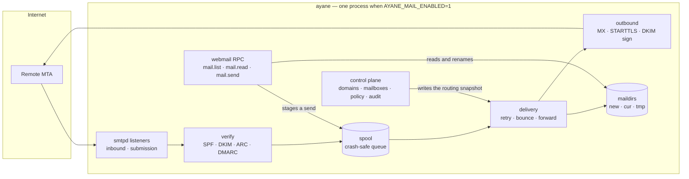

<div align="center">
  
</div>

<h1 align="center">Ayane</h1>

<div align="center">
  <strong>Почтовый сервис Celestia — собственный SMTP-движок, путь чтения maildir и плоскость управления</strong>
</div>

<br />

> **Статус: в эксплуатации.** Плоскость управления, отрисовываемая веб-почта и вход через
> Celestia ID работают в промышленной среде (`mail.acgsyzx.me`). Почтовый движок —
> собственный код этого репозитория: `crates/smtpd` говорит SMTP на приёме и на отправке,
> проверяет SPF/DKIM/ARC/DMARC, доставляет в maildir и отправляет письма чужих доменов по
> MX с подписью DKIM. Веб-почта читает те же maildir напрямую: сервера IMAP в стеке больше
> нет, и Dovecot настраивать не нужно.

## Зачем это нужно

Самостоятельно размещённая почта — решённая задача на уровне *движка* и нерешённая на
уровне *организации*: общие почтовые ящики, catch-all с политикой разрешений и запретов,
карантин, безопасная отрисовка, мастер DNS, по которому оператор действительно может
пройти, и поверхность для агентов. Ayane как раз строит этот слой, а SMTP и формат
maildir говорит сам, вместо того чтобы настраивать чужой демон.

## Имя

Имя происходит от **Ayane Okusora (奥空 アヤネ)** из Blue Archive — в русской записи
«Аянэ Окусора», от японского «пустое небо»: секретарь и офицер связи Комитета контрмер
Абидоса, принципиальная хранительница правил, которая ведёт реестр комитета. Секретарь →
администрирование почтовых ящиков; офицер связи → маршрутизация; хранительница правил →
политика и аудит; реестр → журнал аудита.

Эмблема — нарисованный от руки знак цветными карандашами в домашнем стиле lacrymira,
распространяемый с сайта организации, — кодирует то же прочтение: её нимб в форме
перекрестия прицела (тщательная хранительница реестра), гарнитура с микрофоном на
выносной штанге (офицер связи), конверт (почта) и один красный акцент — её очки в
красной оправе.

## Архитектура



## Движки и лицензии

Почтовый движок — собственный код этого репозитория (SySL 1.0). Всё copyleft остаётся
вне крейта:

| Компонент | Роль | Лицензия | Граница |
|---|---|---|---|
| `ayane-smtpd` | SMTP на приёме и отправке, проверка, очередь, доставка, maildir | SySL 1.0 | этот крейт |
| `ayane-engine` | детерминированные рендереры выведенных из эксплуатации конфигураций Postfix/Dovecot | SySL 1.0 | этот крейт |
| maildir | формат почтового ящика на диске (`new`/`cur`/`tmp` в каждой папке) | — | раскладка файлов |

Намеренно **не** используются: Stalwart (AGPL-3.0), mailcow (GPL-3.0, включает SOGo
AGPL-3.0), Roundcube / SnappyMail (веб-почта своя) и `acme.sh`
(GPL-3.0 — ACME на Rust через `instant-acme`, Apache-2.0). Список разрешённых в
`deny.toml` для `cargo deny` вводит в силу зависимостную сторону этого правила.

## Структура репозитория

```text
ayane/
  crates/
    proto/    wire types + validation (no I/O)
    mail/     routing, recipient policy, MIME construction (lettre, client only)
    engine/   deterministic renderers (the retired Postfix / Dovecot configs)
    smtpd/    the mail engine: SMTP, verification, queue, delivery, maildir reader
    core/     HTTP surface (`ayane` binary)
  deploy/     compose topology, parameter table, Stage-0 verification checklist
  docs/      user-facing documentation
```

## Быстрый старт (разработка)

```bash
cargo run -p ayane
curl -s http://127.0.0.1:3023/api/health
```

Этот адрес привязки — лишь кандидат для локальной разработки; настоящий порт назначает
реестр развёртывания при выкатке сервиса, а переопределяет его `AYANE_LISTEN`.

## Параметры развёртывания

Полная таблица — в [`deploy/README.md`](../../deploy/README.md). Коротко: экземпляр
описывается почтовым доменом (или доменами), публичным именем хоста, источником
сертификата (монтирование / загрузка / ACME), DSN PostgreSQL, исходящим релеем и
начальным администратором. Передавайте их переменными окружения; настоящие значения не
коммитьте никогда.

## План работ

- **Stage 0** — каркас рабочего пространства, рендереры конфигурации, поверхность
  проверки работоспособности, таблица параметров развёртывания и контрольный список
  проверки движков.
- **Stage 1** — почтовый движок (входящий SMTP, проверка, очередь, доставка,
  исходящие) и плоскость управления: домены, учётные записи, псевдонимы, общие ящики,
  политика catch-all, аудит, цикл перезагрузки.
- **Stage 2** — API и интерфейс веб-почты на hikari: безопасная отрисовка, серверный
  прокси изображений, хеширование вложений, предпросмотр в песочнице.
- **Stage 3** — глубина защиты: эвристики фишинга, сценарий карантина, мастер DNS с
  живыми проверками.
- **Stage 4** — инструменты MCP (преимущественно на чтение, отправка с человеком в
  контуре) и подсказки для развёртывания агентами.

## Лицензия

SySL 1.0 — см. [LICENSE](../../LICENSE).
