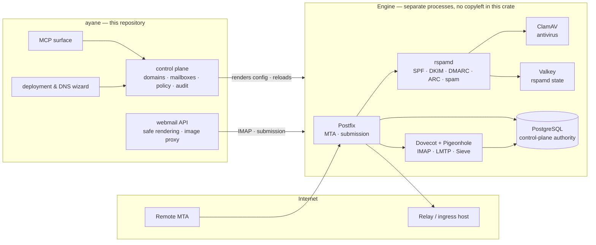

<div align="center">
  
</div>

<h1 align="center">Ayane</h1>

<div align="center">
  <strong>Celestia 自建的邮件服务——管理面、网页客户端与防护层，跑在成熟的 Postfix/Dovecot 栈上</strong>
</div>

<br />

> **状态：已上线。** 控制面、渲染 Webmail、防护层与 Celestia ID 登录已跑在生产
> rig（`mail.acgsyzx.me`）；邮件引擎（Postfix / Dovecot / rspamd / ClamAV）已部署，
> DKIM、SPF、DMARC 齐备。入站 SMTP/25 实测通、rspamd 在门口拒垃圾；对大厂出站在
> 该环境有限流（PTR 已生效，Postfix 自动重试）。

## 为什么要做这件事

自建邮件在**引擎**层是已经解决的问题，在**组织**层却还没有：共享信箱、
带允许/拒绝策略的 catch-all、隔离区、安全渲染、一份运维人员真能照着走的 DNS 向导，
以及一层给 agent 用的接口。Ayane 做的就是这一层，SMTP/IMAP/存储则交给已经在生产
环境跑了数十年的守护进程。

## 名字

名字取自《蔚蓝档案》的**奥空 アヤネ**：阿拜多斯对策委员会的秘书兼通信员，
守规矩、记着委员会的账本。秘书 → 信箱管理；通信员 → 路由；守规矩 → 策略与审计；
账本 → 审计留痕。

徽记是 lacrymira 家族风格的手绘彩铅标志，由组织站点提供，画的正是同一组对应：
准星状光环（一丝不苟的记账人）、带悬臂麦的耳麦（通信员）、信封（邮件），
以及一抹叠在她红框眼镜上的红色强调。

## 架构



## 引擎与许可

Ayane 不持有任何协议实现代码。运行期栈由各自独立的进程组成，每个进程的许可都可以
在不触及本仓库许可的前提下运营与再分发：

| 组件 | 角色 | 许可 | 边界 |
|---|---|---|---|
| Postfix | MTA、submission（587） | IPL-1.0 / EPL-2.0 | 独立进程 |
| Dovecot + Pigeonhole | IMAP、LMTP、Sieve、ACL | LGPL-2.1 | 独立进程 |
| rspamd | 垃圾邮件、DKIM/SPF/DMARC/ARC、milter | Apache-2.0 | 独立进程 |
| ClamAV | 杀毒（由 rspamd 驱动） | GPL-2.0 | 独立进程 |
| Valkey | rspamd 统计 / 限流 | BSD-3-Clause | 独立进程 |
| PostgreSQL | 控制面的权威来源 | PostgreSQL Licence | 库 |

刻意**不用**：Stalwart（AGPL-3.0）、mailcow（GPL-3.0，内含 SOGo AGPL-3.0）、
Roundcube / SnappyMail（网页客户端我们自己出）、`acme.sh`（GPL-3.0——ACME 用
Rust 的 `instant-acme` 实现，Apache-2.0）。`deny.toml` 里的 `cargo deny`
allow-list 负责在依赖一侧执行这条规则。

## 仓库结构

```text
ayane/
  crates/
    proto/    wire types + validation (no I/O)
    mail/     routing, recipient policy, MIME construction (lettre, client only)
    engine/   deterministic renderers for Postfix / Dovecot / rspamd config
    core/     HTTP surface (`ayane` binary)
  deploy/     compose topology, parameter table, Stage-0 verification checklist
  docs/      user-facing documentation
```

## 快速开始（开发）

```bash
cargo run -p ayane
curl -s http://127.0.0.1:3023/api/health
```

这个监听地址只是本地开发的候选值；真实端口在服务部署时由部署账本分配，
`AYANE_LISTEN` 可覆盖。

## 部署参数

完整表格在 [`deploy/README.md`](../../deploy/README.md)。简言之，一个实例由这些描述：
邮件域名、对外主机名、证书来源（挂载 / 上传 / ACME）、PostgreSQL DSN、出站中继，
以及引导管理员。全部以环境变量提供；真实值绝不进版本库。

## 路线图

- **Stage 0** — 工作区骨架、配置渲染器、健康检查面、部署参数表与引擎验证清单。
- **Stage 1** — 引擎 compose（Postfix/Dovecot/rspamd/ClamAV/Valkey）与控制面：
  域名、账号、别名、共享信箱、catch-all 策略、审计、渲染配置重载循环。
- **Stage 2** — 建在 hikari 上的 Webmail API 与界面：安全渲染、服务端图片代理、
  附件哈希、沙箱预览。
- **Stage 3** — 防护纵深：钓鱼启发式判断、隔离区流程、带活体检查的 DNS 向导。
- **Stage 4** — MCP 工具（以读为主、发信需人在环内）与 agent 部署提示词。

## 许可

SySL 1.0——见 [LICENSE](../../LICENSE)。
