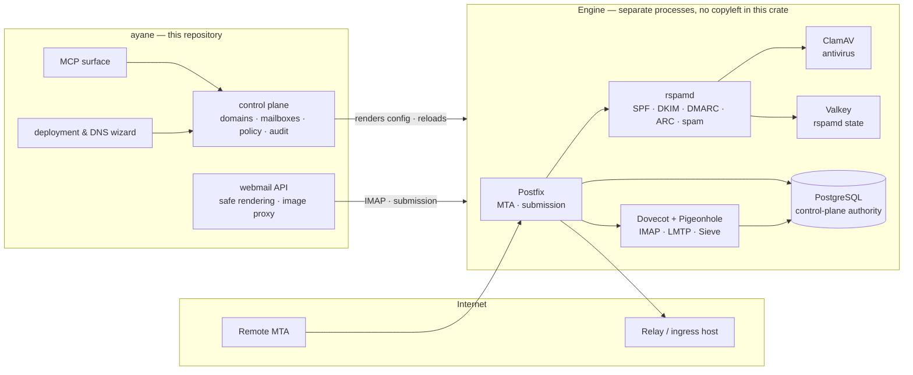

<div align="center">
  
</div>

<h1 align="center">Ayane</h1>

<div align="center">
  <strong>Celestia 自建的郵件服務——控制平面、Webmail 與防護層，跑在成熟的 Postfix/Dovecot 堆疊上</strong>
</div>

<br />

> **狀態：已上線。** 控制平面、渲染式 Webmail、防護層與 Celestia ID 登入都已跑在生產
> rig（`mail.acgsyzx.me`）上；郵件引擎（Postfix / Dovecot / rspamd / ClamAV）已部署，
> DKIM、SPF、DMARC 齊備。入站 SMTP/25 實測可用，rspamd 在入口就攔下垃圾信；往大型
> 業者的出站在該環境受到速率限制（PTR 已生效，Postfix 自動重試）。

## 為什麼要有這個專案

自架郵件在**引擎**層是已解決的問題，在**組織**層卻還沒：共用信箱、帶允許／拒絕
策略的 catch-all、隔離區、安全渲染、一份營運者真的跟得下去的 DNS 精靈，以及一層
給 agent 用的介面。Ayane 做的就是這一層，SMTP／IMAP／儲存則交給已經在生產環境跑了
幾十年的常駐程式。

## 名字

名字取自《蔚藍檔案》的**奧空 アヤネ**：阿拜多斯對策委員會的祕書兼通訊員，
守規矩、掌著委員會的帳冊。祕書 → 信箱管理；通訊員 → 路由；守規矩 → 策略與稽核；
帳冊 → 稽核軌跡。

徽記是 lacrymira 家族風格的手繪色鉛筆標誌，由組織站點提供，畫的正是同一組對應：
準星狀光環（分毫不差的掌帳者）、附懸臂麥克的耳麥（通訊員）、信封（郵件），以及
一抹疊在她紅框眼鏡上的紅色強調。

## 架構



## 引擎與授權

Ayane 不持有任何協定實作程式碼。執行期堆疊由各自獨立的行程組成，每個行程的授權
都可以在不觸及本倉庫授權的前提下營運與再散布：

| 元件 | 角色 | 授權 | 邊界 |
|---|---|---|---|
| Postfix | MTA、submission（587） | IPL-1.0 / EPL-2.0 | 獨立行程 |
| Dovecot + Pigeonhole | IMAP、LMTP、Sieve、ACL | LGPL-2.1 | 獨立行程 |
| rspamd | 垃圾信、DKIM/SPF/DMARC/ARC、milter | Apache-2.0 | 獨立行程 |
| ClamAV | 防毒（由 rspamd 驅動） | GPL-2.0 | 獨立行程 |
| Valkey | rspamd 統計／速率限制 | BSD-3-Clause | 獨立行程 |
| PostgreSQL | 控制平面的權威來源 | PostgreSQL Licence | 函式庫 |

刻意**不用**：Stalwart（AGPL-3.0）、mailcow（GPL-3.0，內含 SOGo AGPL-3.0）、
Roundcube / SnappyMail（Webmail 由我們自己出）、`acme.sh`（GPL-3.0——ACME 以 Rust 的
`instant-acme` 實作，Apache-2.0）。`deny.toml` 裡的 `cargo deny` allow-list 負責在
相依一側執行這條規則。

## 倉庫結構

```text
ayane/
  crates/
    proto/    wire types + validation (no I/O)
    mail/     routing, recipient policy, MIME construction (lettre, client only)
    engine/   deterministic renderers for Postfix / Dovecot / rspamd config
    core/     HTTP surface (`ayane` binary)
  deploy/     compose topology, parameter table, Stage-0 verification checklist
  docs/      user-facing documentation
```

## 快速開始（開發）

```bash
cargo run -p ayane
curl -s http://127.0.0.1:3023/api/health
```

這個綁定位址只供本機開發使用；實際連接埠由部署帳冊在服務部署時分配，
`AYANE_LISTEN` 可覆寫。

## 部署參數

完整表格在 [`deploy/README.md`](../../deploy/README.md)。簡言之，一個實例由以下幾項
描述：郵件網域、對外主機名、憑證來源（掛載／上傳／ACME）、PostgreSQL DSN、出站中繼，
以及啟動管理員。這些都以環境變數提供；真實數值絕不進版本庫。

## 路線圖

- **Stage 0** — 工作區骨架、設定渲染器、健康檢查介面、部署參數表與引擎驗證清單。
- **Stage 1** — 引擎 compose（Postfix/Dovecot/rspamd/ClamAV/Valkey）與控制平面：
  網域、帳號、別名、共用信箱、catch-all 策略、稽核、渲染設定重載迴圈。
- **Stage 2** — 建在 hikari 上的 Webmail API 與介面：安全渲染、伺服器端圖片代理、
  附件雜湊、沙箱預覽。
- **Stage 3** — 防護深度：釣魚啟發式判斷、隔離區流程、帶即時檢查的 DNS 精靈。
- **Stage 4** — MCP 工具（以讀為主、寄送需人在迴路中）與 agent 部署提示詞。

## 授權

SySL 1.0——見 [LICENSE](../../LICENSE)。
